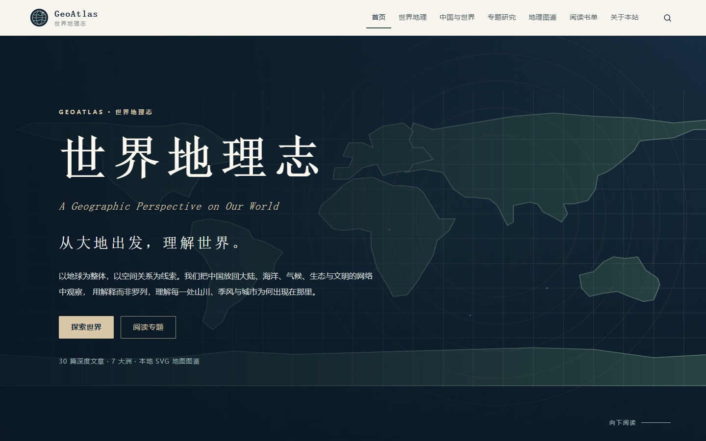
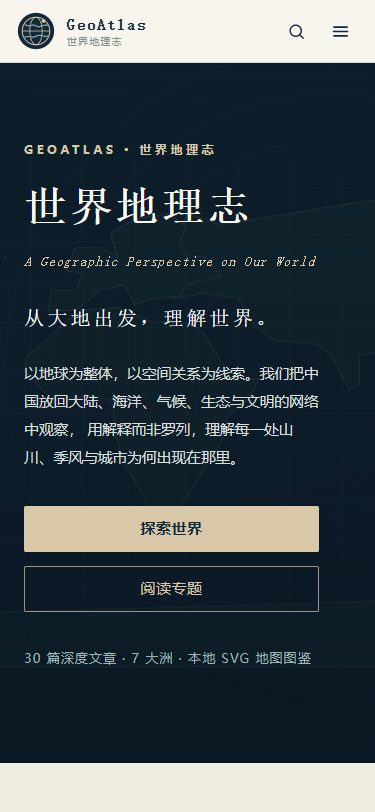
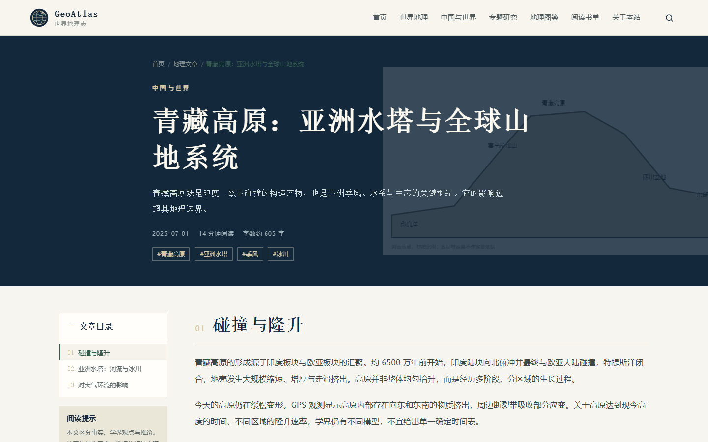

<div align="center">
  
  <h1>GeoAtlas · 世界地理志</h1>
  <p><strong>A Geographic Perspective on Our World</strong></p>
  <p><em>从大地出发，理解世界。</em></p>
</div>

---

## 一、项目简介

**世界地理志（GeoAtlas）** 是一个面向中文读者的世界地理知识网站。它以大地理观为核心，把中国地理放入全球大陆、海洋、气候、生态、文明与经济网络中观察、比较和理解，而不是孤立介绍中国地理。

这不是一个地理导航页，而是一份具有编辑出版品质的数字地理杂志与知识图谱：内容强调机制解释、空间联系、尺度转换、历史演变与因果分析；区分事实、学术观点、推论与争议；对可变数据标注来源与年份。

项目目前包含 **30 篇中文深度文章**、**7 个大洲详情页**、**11 张本地 SVG 图鉴插图**、**12 本精选读物** 与 **6 个专题合集**，可完全静态部署到 GitHub Pages。

---

## 二、网站理念

1. 以地球为整体研究对象，以空间关系为核心。
2. 以自然地理为基础，结合人文、经济、历史、政治与环境地理。
3. 将中国放在全球大陆、海洋、气候、生态和文明网络中理解。
4. 重视区域比较、地理联系、尺度转换、历史演变与因果机制。
5. 文章要有解释力，不只罗列地理事实。
6. 区分事实、学术观点、推论和存在争议的问题。
7. 对数据、人口、面积、气候、资源等可变信息标注来源与年份。
8. 不编造书籍、作者、论文、数据和参考文献。
9. 主要内容使用简体中文，专业术语可附英文。
10. 不用空洞的营销语言代替真正的地理知识。

---

## 三、真实网页截图

以下截图由本地开发服务器（Vite）在真实 Chromium 浏览器中截取，未使用设计稿或伪造图片。

### 首页 · 桌面端（1440 × 900）



### 首页 · 手机端（375 × 812）



### 文章详情 · 桌面端（1440 × 900）



---

## 四、网站功能

- 独立设计的首页 Hero：世界地形风格 SVG 背景、暗色遮罩、网站介绍与双入口按钮。
- 首页十大内容区块：世界观察、认识地球、七大洲、中国与世界、自然地理、人文与文明、深度文章、地理阅读、地图图鉴、Footer。
- 全站响应式导航：桌面横向导航、移动端折叠菜单。
- 本地搜索：可检索文章标题、摘要、分类、标签与核心概念，按相关度排序。
- 文章分类筛选与标签筛选，支持 URL 参数分享筛选状态。
- 文章详情：目录锚点跳转、阅读进度条、相关概念、参考资料、延伸阅读。
- 地图与图鉴：本地 SVG 可放大查看，支持缩放按钮与 Esc 关闭。
- 回到顶部、面包屑导航、图片懒加载、语义化 HTML 与基础无障碍支持。
- 独立页面 SEO：`title`、`description`、Open Graph、sitemap.xml、robots.txt。
- GitHub Pages 子路径部署与刷新回退（`404.html` + `sessionStorage` 重定向）。

---

## 五、页面结构

| 路由 | 页面 | 说明 |
| --- | --- | --- |
| `/` | 首页 | 独立 Hero + 十个内容区块 |
| `/world` | 世界地理 | 全球格局总览与入口 |
| `/continents` | 七大洲 | 七洲概览 |
| `/continents/:slug` | 大洲详情 | 构造、气候、区域与事实卡 |
| `/china-world` | 中国与世界 | 重点内容模块 |
| `/physical-geography` | 自然地理 | 山脉、河流、海洋、气候等 |
| `/human-geography` | 人文地理 | 文明、人口、城市、语言、迁徙 |
| `/economic-geography` | 经济地理 | 区位、分工、能源与贸易 |
| `/historical-geography` | 历史地理 | 文明起源、通道与环境变迁 |
| `/topics` | 专题研究 | 6 个文章合集 |
| `/articles` | 地理文章 | 30 篇，支持分类/标签/关键词筛选 |
| `/articles/:slug` | 文章详情 | 目录、正文、概念、参考资料 |
| `/atlas` | 地理图鉴 | 11 张可放大的 SVG 地图与示意图 |
| `/books` | 阅读书单 | 12 本读物与 3 条阅读路径 |
| `/about` | 关于本站 | 理念、编辑规范、数据来源、许可 |
| `/search` | 搜索 | 纯前端本地搜索 |
| `*` | 404 | 离线地图风格错误页 |

---

## 六、技术栈

- **Vite 5** — 构建工具与开发服务器
- **React 18 + TypeScript** — 界面与类型安全
- **React Router 6** — 客户端路由
- **原生 CSS** — 单一设计系统文件 `src/styles/global.css`，无 UI 组件库
- **本地结构化数据** — 文章、大洲、书籍、专题均为 TypeScript 数据模块
- **本地 SVG** — 地图、插图、图标均由项目脚本生成，无外部图片 URL
- **GitHub Actions** — 自动构建并部署到 GitHub Pages

运行时依赖只有 `react`、`react-dom`、`react-router-dom`；开发依赖仅 Vite、TypeScript 与 React 插件。未使用 Next.js、后端、数据库、大型 UI 库或第三方 CDN。

---

## 七、项目目录结构

```text
geo-atlas/
├── .github/workflows/deploy.yml      # GitHub Pages 自动部署
├── docs/
│   ├── screenshots/                  # 真实浏览器截图
│   │   ├── home-desktop.png
│   │   ├── home-mobile.png
│   │   └── article-desktop.png
│   ├── image-sources.md              # 图片与地图资源来源
│   └── content-sources.md            # 内容来源与引用规范
├── public/
│   ├── .nojekyll
│   ├── robots.txt
│   ├── icons/logo.svg
│   ├── images/hero/hero-world.svg
│   ├── images/continents/*.svg       # 七大洲
│   ├── maps/*.svg                    # 世界与中国地图/示意图
│   └── illustrations/*.svg           # 圈层、贸易网络
├── scripts/
│   ├── generate-assets.mjs           # SVG 资源生成脚本
│   └── postbuild.mjs                 # 生成 404.html 回退页
├── src/
│   ├── components/                   # Header/Footer/Hero/卡片/目录/地图查看器等
│   ├── data/
│   │   ├── articles/part1.ts         # 地球与全球格局、世界区域地理
│   │   ├── articles/part2.ts         # 区域地理、中国与世界
│   │   ├── articles/part3.ts         # 中国与世界、人文与经济地理
│   │   ├── articles/index.ts         # 搜索、筛选与关联文章
│   │   ├── articles/refs.ts          # 共享参考资料
│   │   ├── books.ts / continents.ts / topics.ts / site.ts / types.ts
│   ├── pages/                        # 全部路由页面
│   ├── styles/global.css             # 设计系统与响应式布局
│   ├── utils/assets.ts               # 子路径安全的资源 URL 辅助函数
│   ├── App.tsx / main.tsx / vite-env.d.ts
├── index.html
├── package.json / package-lock.json
├── tsconfig.json / vite.config.ts
└── README.md
```

---

## 八、本地运行

要求 Node.js 18+（推荐 20 或 22）。

```bash
# 安装依赖
npm install

# 启动开发服务器
npm run dev
```

默认访问 `http://localhost:5173/`。开发模式下 `base` 为 `/`，便于本地调试。

### 构建与本地预览

```bash
# 类型检查 + 构建 + 生成 404.html + 生成 sitemap.xml
npm run build

# 预览构建产物
npm run preview
```

构建产物位于 `dist/`。生产构建的 `base` 为 `/geo-atlas/`，与 GitHub 仓库名对应。

### 重新生成 SVG 资源

```bash
node scripts/generate-assets.mjs
```

---

## 九、GitHub Pages 部署

1. 在 GitHub 创建名为 `geo-atlas` 的新仓库（不要勾选初始化 README，或先删除自动生成的 README）。
2. 将本目录内容推送到仓库 `main` 分支：

   ```bash
   git init
   git add .
   git commit -m "feat: initial GeoAtlas site"
   git remote add origin https://github.com/yuxinrun/geo-atlas.git
   git branch -M main
   git push -u origin main
   ```

3. 进入仓库 **Settings → Pages**，在 **Build and deployment** 中将 **Source** 选择为 **GitHub Actions**。
4. 推送后 `.github/workflows/deploy.yml` 会自动执行 `npm ci`、`npm run build` 并部署到 Pages。
5. 部署完成后访问：

   ```text
   https://yuxinrun.github.io/geo-atlas/
   ```

### 部署注意事项

- 当前配置已按 `https://yuxinrun.github.io/geo-atlas/` 设置（`canonical`、仓库链接、`robots.txt`、`sitemap.xml` 基地址均已写入）。若仓库名不是 `geo-atlas`，请同步修改 `vite.config.ts` 中的 `base`、`scripts/postbuild.mjs` 中的重定向路径、`index.html` 的 `canonical`、以及 `public/robots.txt` 与 `vite.config.ts` 中的 `BASE_URL`，否则静态资源路径会出错。
- `404.html` 由 `scripts/postbuild.mjs` 从 `index.html` 生成，内含 `sessionStorage` 重定向脚本，用于解决刷新子路由时的 404 问题。
- `public/.nojekyll` 阻止 Jekyll 处理以点开头的文件；工作流中也再次写入 `dist/.nojekyll`。
- 所有资源引用通过 `asset()` 辅助函数拼接 `import.meta.env.BASE_URL`，因此支持子路径部署。

---

## 十、图片与地图数据来源

详见 [`docs/image-sources.md`](./docs/image-sources.md) 与 [`docs/content-sources.md`](./docs/content-sources.md)。

要点：

- 网站**不引用任何外部图片 URL**。所有 Hero 背景、大洲图、地图和图标都保存在 `public/` 下。
- 当前版本未使用第三方摄影照片；复杂地理图像均由本站自绘 SVG 承担，保证许可清晰与离线可部署。
- SVG 基于简化的经纬度控制点生成，参考 **Natural Earth**（公共领域）的海陆关系。
- 内容参考 **IPCC AR6**、**联合国人口司**、**USGS**、**NASA Earth Observatory**、**FAO**、**世界银行** 等公开来源，并在文章中标注年份或链接。
- 地图为教学示意图，**不作为国界、行政区划、航海、工程或防灾依据**。

---

## 十一、内容版权与引用规范

- 本站原创文字与 SVG 插图采用 **CC BY-NC 4.0**（署名-非商业性使用 4.0 国际）许可，除非单篇另有声明。
- 外部来源内容的版权归原权利人所有；本站只作事实引用与出处指引。
- 可变数据标注来源年份；无法确认版本的中文读物标注“待核查”。
- 明确区分事实、学术观点、推论与争议，不把推测写成定论。
- 不编造文献、作者、数据或截图。

---

## 十二、验收记录

- [x] 首页独立 Hero 与十个内容区块
- [x] 16 个主要路由 + 404 全部可访问
- [x] 30 篇实质性中文文章
- [x] 7 个大洲详情页
- [x] 11 张本地 SVG 地图/示意图，无外链图片
- [x] 搜索、分类筛选、标签筛选、目录锚点、阅读进度、地图放大、回到顶部、移动端菜单
- [x] 320 / 375 / 768 / 1024 / 1440 宽度无横向溢出
- [x] 真实浏览器截图三张
- [x] `npm run build` 成功，TypeScript 无错误
- [x] GitHub Actions 与 Pages 子路径配置完成
- [x] 浏览器控制台无错误（清空会话后复查）

---

## 十三、后续规划

1. 持续扩充“中国与世界”系列，增加水文、农业、城市与区域比较专题。
2. 增加更多图鉴示意图，并补充投影、比例尺与数据版本说明。
3. 为文章建立版本与更新日期记录，追踪数据变化。
4. 在确认许可与署名后，逐步引入开放许可的地理摄影图片。
5. 增加文章间概念图谱与结构化数据标记（JSON-LD），提升检索与引用体验。
6. 建立内容审校流程，对数据密集文章做定期复核。

---

**GeoAtlas · 世界地理志 — 从大地出发，理解世界。**
